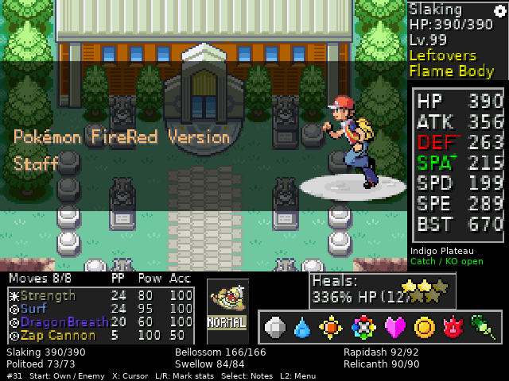

# Validation and a completed handheld run

## Owner-completed run

The owner completed FireRed's main story in **Run 31** on a **Miyoo Mini Plus**
using this port, the original Tracker and Onion's gpSP core. The final checkpoint
was saved on **10 October 2026** and inspected on **26 October 2026**.

The records show **all eight badges**, the **game-clear flag** and **one Hall of
Fame entry**. The first Hall of Fame in-game time is **13:22:39**; fast-forward
affects this clock, so it is not a wall-clock play-time measurement.

### Hall of Fame team

| Pokémon | Level |
| --- | ---: |
| **Slaking** | **99** |
| Bellossom | 36 |
| Rapidash | 24 |
| Politoed | 21 |
| Swellow | 25 |
| Relicanth | 30 |

Slaking's final setup: **Flame Body**, **Leftovers**, **Strength / Surf /
DragonBreath / Zap Cannon**. Species, abilities and moves reflect this
randomized run.

### What was checked

- The completion flag and Hall of Fame counter in a read-only copy of the final checkpoint.
- The checksums and signatures of both Hall of Fame flash-save sectors.
- Agreement between the six recorded Hall of Fame species/levels and the final party.
- Valid checksums on all six encrypted party records, and eight badges in both game data and the rule journal.
- Resuming a copy of that checkpoint on the real Miyoo/gpSP core and capturing the ending credits.

The live German installation and its run files were retained. The screenshot
uses the English release frontend in the separate QA installation, with a copy
of the completed checkpoint. The game-clear flag, party and save records were
not edited for the capture. Only the rendered image and this summary are
published; the ROM, BIOS, checkpoint, SRAM and Tracker files remain private.

### Development-run repairs

This run began during development and continued through bug fixes. It included
recovery from a false run-ending penalty for the mandatory Pokémon Tower ghost,
and an inventory reconstruction after the Safari menu bag bug. The bag was
reconstructed from an older backup, newly collected item flags and the run's
randomized ROM, accounting for items transferred to Pokémon. Exact intervening
item quantities could not all be recovered; the owner accepted that uncertainty.

The completion is evidence that the main story can be finished on the handheld.
It does not establish exhaustive coverage of the rule guards or all story paths.

## Automated and focused device checks

The release has host installer/ROM-preparation tests, simulated-memory ARM rule
tests and focused actual-gpSP scenarios. They cover party encryption and safe
death handling, tutorial and Tower exceptions, Safari menu/bag key transitions,
Tracker UI/layouts, and setup/update/backup behavior.

See [BUILD.md](../BUILD.md), [the changelog](../CHANGELOG.md) and
[the AI disclosure](../AI_USAGE.md) for their scope. A complete automated
story playthrough is still absent. Other devices and firmware versions remain
unverified; the tested firmware baseline is Onion
**v4.4.0-beta-20260120-07505ea5** on Miyoo Mini Plus.

## Sources for interpreting the completion data

FireRed structure references use pret commit
`037335f4c725d7c9aecdac87066f2002b4bd7e14`:

- [Hall of Fame records](https://github.com/pret/pokefirered/blob/037335f4c725d7c9aecdac87066f2002b4bd7e14/src/hall_of_fame.c).
- [Save-sector layout](https://github.com/pret/pokefirered/blob/037335f4c725d7c9aecdac87066f2002b4bd7e14/include/save.h) and [signature/checksum handling](https://github.com/pret/pokefirered/blob/037335f4c725d7c9aecdac87066f2002b4bd7e14/src/save.c).
- [Save blocks and play-time fields](https://github.com/pret/pokefirered/blob/037335f4c725d7c9aecdac87066f2002b4bd7e14/include/global.h), [completion and badge flags](https://github.com/pret/pokefirered/blob/037335f4c725d7c9aecdac87066f2002b4bd7e14/include/constants/flags.h), [game-stat IDs](https://github.com/pret/pokefirered/blob/037335f4c725d7c9aecdac87066f2002b4bd7e14/include/constants/game_stat.h) and [encrypted stat access](https://github.com/pret/pokefirered/blob/037335f4c725d7c9aecdac87066f2002b4bd7e14/src/event_data.c).
- [Pokémon data structures](https://github.com/pret/pokefirered/blob/037335f4c725d7c9aecdac87066f2002b4bd7e14/include/pokemon.h), [encryption/checksums](https://github.com/pret/pokefirered/blob/037335f4c725d7c9aecdac87066f2002b4bd7e14/src/pokemon.c), [species](https://github.com/pret/pokefirered/blob/037335f4c725d7c9aecdac87066f2002b4bd7e14/include/constants/species.h), [moves](https://github.com/pret/pokefirered/blob/037335f4c725d7c9aecdac87066f2002b4bd7e14/include/constants/moves.h), [abilities](https://github.com/pret/pokefirered/blob/037335f4c725d7c9aecdac87066f2002b4bd7e14/include/constants/abilities.h) and [items](https://github.com/pret/pokefirered/blob/037335f4c725d7c9aecdac87066f2002b4bd7e14/include/constants/items.h).
- [Tracker 9.4.0 FireRed v1.1 addresses](https://github.com/besteon/Ironmon-Tracker/blob/v9.4.0/ironmon_tracker/GameAddresses/Pokemon%20FireRed%20v1.1.json).

[All project sources and credits](../SOURCES.md) ·
[Screenshot provenance](images/README.md) · [Back to the project](../README.md)
